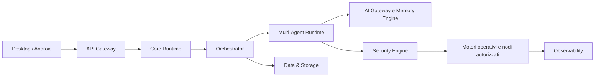
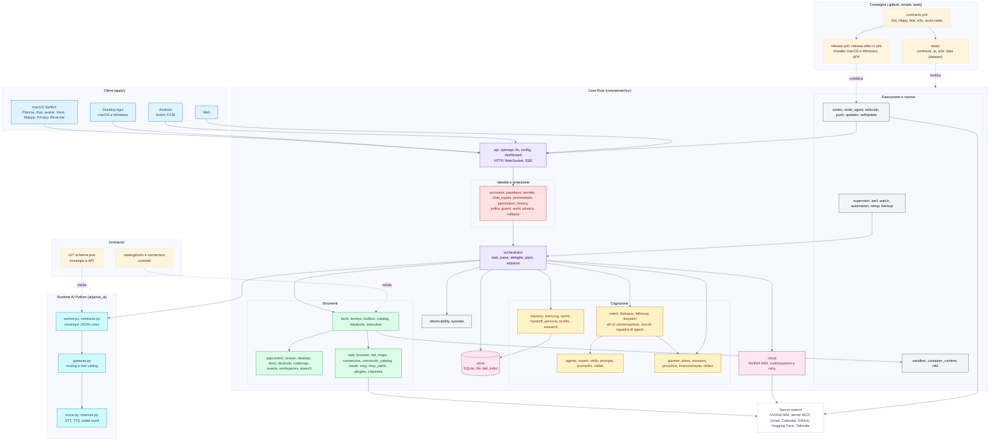
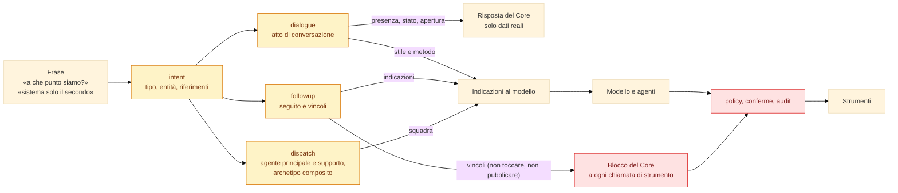
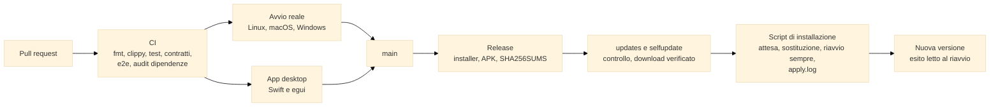
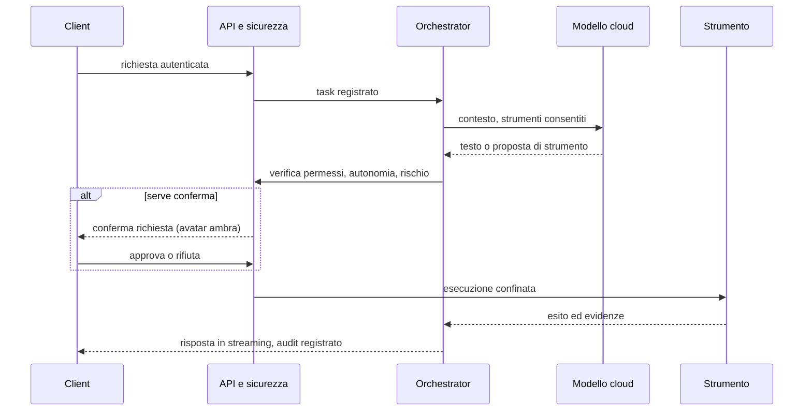

# Architettura JARVIS

Il Core Linux è il coordinatore principale. I nodi autorizzati dichiarano capacità e stato, applicano policy locali ed eseguono le attività assegnate. La topologia prevede LAN, accesso remoto tramite VPN mesh, comunicazione diretta e relay dove necessario. La perdita della rete lascia disponibili le capacità locali e sospende quelle che dipendono dal Core remoto o dal cloud.

### Mappa del repository

Il diagramma segue i moduli realmente presenti nel codice (`core/server/src`, `ai/jarvis_ai`, `apps`, `contracts`, `.github`): le frecce indicano chi chiama chi e **ogni modulo del Core compare almeno una volta**. Un test (`tests/contracts/test_architecture_diagram.py`) lo verifica a ogni modifica, così il diagramma non resta indietro rispetto al codice. Si può usare anche come ingresso per strumenti di visualizzazione dei repository.

#### Da una frase a un risultato (cognizione)

Come una frase del proprietario diventa lavoro, senza mai concedere permessi per il solo fatto di averla capita:

#### Consegna e aggiornamento

### Ciclo di una richiesta

| Modulo | Responsabilità |
|---|---|
| Core Runtime | Lifecycle, configurazione, health, risorse, code e scheduling |
| Orchestrator | Piani, dipendenze, delega, stato, annullamento e verifica |
| Multi-Agent Runtime | Identità, contesto e strumenti degli agenti, lifecycle delle deleghe |
| AI Gateway | Contratto comune per inferenza, streaming, tool calling e routing |
| Memory Engine | Memoria autorizzata, recupero, consolidamento e correzione |
| Voice Engine | Acquisizione, wake word, STT, TTS e stream vocale |
| Computer Use Engine | Operazioni OS, file, terminale e interfacce di un nodo |
| Web Agent Engine | Ricerca, navigazione, interazione e verifica fonti |
| Voice Engine | STT, TTS e parola di attivazione locali nel worker; acquisizione e riproduzione nell'interfaccia | `ai/jarvis_ai/voice.py`, `core/server/src/api.rs` (`/api/voice/*`) |
| Client desktop | App egui che avvia e supervisiona il Core, o si associa a un Core remoto | `apps/desktop` |
| Automation Engine | Trigger, esecuzioni durevoli, monitoraggio e recupero |
| Integration Engine | API, connettori, plugin, SDK e webhook |
| Security Engine | Identità, decisioni di policy, rischio e audit |
| Data & Storage Engine | Persistenza, file, sincronizzazione, backup e conflitti |
| Observability Engine | Log, metriche, trace, salute e diagnostica |

Un client autentica la richiesta. Il Core registra il task, l'Orchestrator lo scompone, gli agenti propongono le operazioni e il controllo di policy precede l'esecuzione. Ogni esecutore restituisce stato ed evidenze. L'Orchestrator verifica le condizioni di completamento e pubblica lo stato al client. Consultare [AUTONOMY_AND_TOOLS.md](AUTONOMY_AND_TOOLS.md) per esiti incerti e ripresa.

I confini applicativi usano contratti versionati. Ogni modulo espone responsabilità, API, eventi, errori, permessi e segnali di salute. Le scritture passano dal modulo proprietario. Usare HTTP per richieste, WebSocket per aggiornamenti, code persistenti per lavoro differito. RPC ed event bus specifici richiedono una scelta tecnica. Nel frattempo il prototipo di confine Core–AI usa JSON Lines su stdio con `jarvis.envelope/1` (ADR-0003, `core/bridge`). Iniziare con moduli coesi e separare processi o servizi quando il confine di isolamento, prestazioni o distribuzione lo richiede. Il deployment usa systemd e Docker.

La disposizione proposta dei moduli nel repository è descritta in [DEVELOPMENT.md](DEVELOPMENT.md). Il monorepo conserva assieme codice, specifiche, contratti e verifiche.

## Stato del prototipo v0.1

| Modulo previsto | Implementazione attuale | Codice |
|---|---|---|
| API Gateway e client nativi | API HTTP locale per app desktop e Android | `core/server/src/api.rs`, `apps/desktop`, `apps/android` |
| Core Runtime e Orchestrator | Task `jarvis.task/1`, delega, ripresa dopo conferma, una richiesta alla volta | `core/server/src/orchestrator.rs` |
| Multi-Agent Runtime | Un agente (General Assistant) in un worker Python supervisionato e riavviato se termina | `core/bridge`, `ai/jarvis_ai/worker.py` |
| AI Gateway | Ollama locale e modello offline, con degradazione dichiarata | `ai/jarvis_ai/gateway.py` |
| Security Engine | Policy a regole, conferme monouso, audit a catena di hash | `core/server/src/policy.rs`, `audit.rs` |
| Computer Use (parziale) | File nella workspace e informazioni di sistema | `core/server/src/tools.rs` |
| Memory e Data & Storage | Memoria, task e conversazione in SQLite | `core/server/src/store.rs` |

| Automation Engine | Workflow pianificati, pianificatore nel Core, cronologia, approvazione legata ai passi | `core/server/src/automation.rs`, `orchestrator.rs` |
| Observability (parziale) | Notifiche correlate, monitor delle anomalie, metriche di latenza ed errori, log strutturati correlati | `observability.rs`, `orchestrator.rs`, `/api/metrics` |
| Web Agent (parziale) | Ricerca (Wikipedia o SearXNG) e lettura di pagine con provenienza, difese SSRF e iniezione | `core/server/src/web.rs` |

Il client Web/PWA non è distribuito; il Core serve solo API HTTP ai client nativi. La UI egui non ha ancora parità con tutte le schermate e le funzioni vocali precedenti. Non ancora implementati: navigazione interattiva con Playwright, Integration Engine, nodi distribuiti, sincronizzazione, metriche e trace.
